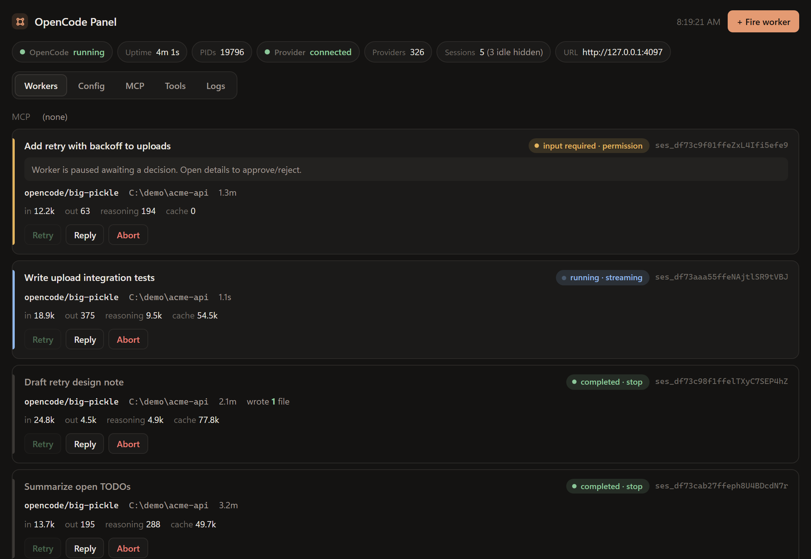
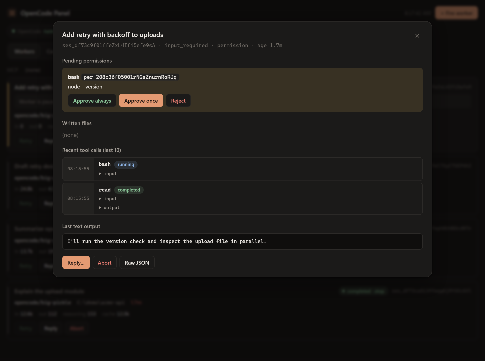
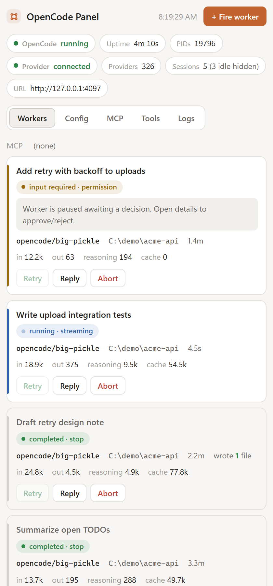

# OpenCode Panel

A live, single-file web dashboard for an [OpenCode](https://opencode.ai) server: watch
worker sessions as they run, fire new ones, answer permission prompts, and manage the
server, its providers and MCP connectors from one page.

It reads the OpenCode server, not the agent that started the work. Workers from any coding
agent or tool that drives OpenCode show up here, in every project on that server, and the
dashboard opens in any browser.



## Features

- **Workers** - live session cards over SSE for every project on the server: status, model,
  token use, tool-call and text tails, files written. Fire, retry, reply and abort from the
  page. A worker that stops for a permission or a question opens its details so you can
  answer it there.
- **Config** - server status with stop/start/restart, provider connection check, masked
  view of provider key environment variables.
- **MCP** - configured and runtime MCP connectors; add, remove, test.
- **Tools** - a generic OpenCode HTTP invoker with a JSON tree view.
- **Logs** - the dashboard's own log buffer.
- **Viewer** - `/view?path=...` renders Markdown and source files from allowed directories.

## Screenshots

| Answering a permission request | In a narrow side pane, light theme |
|---|---|
|  |  |

## Compatibility

| | Works with | How it was checked |
|---|---|---|
| **Agents** | Any MCP client that drives OpenCode through an OpenCode MCP server such as [opencode-mcp](https://www.npmjs.com/package/opencode-mcp), plus the OpenCode TUI and scripts using its HTTP API | Tested with Claude Code. Other agents follow from the design: the dashboard reads sessions from the OpenCode server and never talks to the agent |
| **Browsers** | Any modern browser. Standard web APIs only (`fetch`, `EventSource`, Clipboard) | Tested in Chromium |
| **Providers and models** | Every model of every provider OpenCode reports as connected. Fire offers only those, and refuses anything else instead of starting a worker that cannot run | Tested on two models of the `opencode` provider |
| **Operating systems** | Monitoring, firing, permission replies, MCP and the viewer on any OS. Server stop/start/restart and process detection on Windows only (PowerShell and `opencode.cmd`) | Tested on Windows |

## Requirements

- Python 3.8 or newer (tested on 3.14). Standard library only; nothing to install.
- An OpenCode server (`opencode serve`), by default at `http://127.0.0.1:4096`. Tested with
  OpenCode 1.19.5.

## Run

```
python opencode-panel.py
```

Then open http://127.0.0.1:7777. On Windows, `opencode-panel.cmd` starts it in the background.

The page follows the system light or dark setting and fits a narrow side pane. Add `?theme=light`
or `?theme=dark` to the URL to force one.

| Option | Default | Meaning |
|---|---|---|
| `--port` | `$PORT`, then `$OPENCODE_PANEL_PORT`, then 7777 | Dashboard port |
| `--opencode` | `http://127.0.0.1:4096` | OpenCode server URL |
| `--view-root DIR` | working directory | Extra directory the file viewer may read; repeatable. `OPENCODE_PANEL_VIEW_ROOTS` adds more, separated by `;` on Windows and `:` elsewhere |
| `--filter` | none | Only show sessions whose title starts with this prefix |
| `--cwd-filter` | none | Only show sessions whose directory contains this text |
| `--idle-cutoff-sec` | 300 | Hide finished sessions idle longer than this. Failed sessions stay six times as long |

### Inside an agent

An agent with a built-in browser can show the dashboard beside the conversation; open
http://127.0.0.1:7777 there. If the agent launches dev servers itself, point it at
`opencode-panel.py`. The dashboard listens on `$PORT` when one is assigned.

For example, Claude Code's preview pane takes an entry in `.claude/launch.json`:

```json
{
  "name": "opencode-panel",
  "runtimeExecutable": "python",
  "runtimeArgs": ["/path/to/opencode-panel.py"],
  "port": 7777
}
```

## API keys

The dashboard stores no credentials. OpenCode keeps provider keys in its own `auth.json`
(set with `opencode auth login`) or reads them from environment variables. The Config tab
only reports whether the provider is connected and shows masked environment values.

## Security

The dashboard can drive OpenCode, and OpenCode can run shell commands. So:

- It listens on `127.0.0.1` only, has no authentication, and is meant for a single-user
  machine.
- It refuses requests whose `Host` is not a loopback name (DNS rebinding) and requests
  whose `Origin` is another site (cross-site requests).
- The file viewer reads only from the working directory and the roots you add.
- Do not expose it, or the OpenCode server, on a network interface.

## License

MIT
